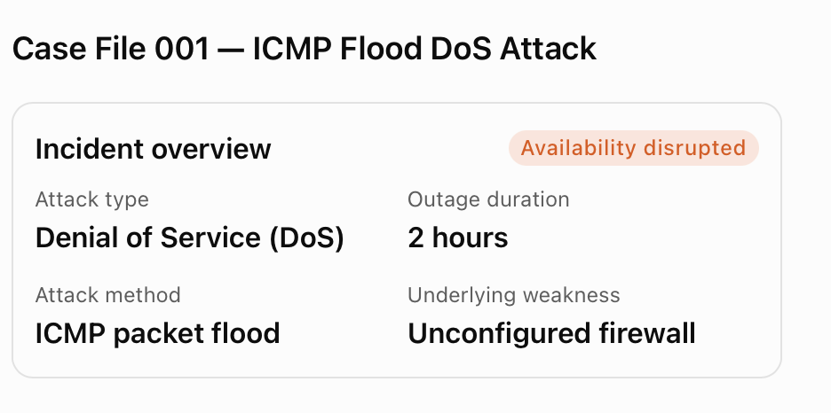

# Case File 001 — ICMP Flood DoS Incident Analysis

> **Simulated incident / cybersecurity coursework.** This project analyzes a fictional multimedia company's network outage using the five NIST Cybersecurity Framework (CSF) functions taught in Google's *Connect and Protect: Networks and Network Security* course. It is not an investigation of a real organization or evidence of a live penetration test.

## At a glance

| Item | Finding |
| --- | --- |
| Incident | Internet Control Message Protocol (ICMP) flood denial-of-service (DoS) attack |
| Business context | Multimedia firm providing web design, graphic design, and social media marketing |
| Observed impact | Internal network resources inaccessible for approximately 2 hours |
| Primary CIA objective affected | **Availability** |
| Reported root weakness | Unconfigured or inadequately configured firewall |
| Analytical framework | **Identify → Protect → Detect → Respond → Recover** |

## Executive summary

A malicious actor flooded a multimedia company's network with inbound ICMP packets. Network services stopped responding, preventing normal internal traffic from accessing network resources for two hours. The incident management team temporarily blocked inbound ICMP packets, shut down non-critical services, and restored critical connectivity. Investigation identified ineffective firewall configuration as the key weakness that allowed the flood to reach the network.

The scenario states that the security team subsequently introduced ICMP rate limits, source-IP verification, network monitoring, and IDS/IPS filtering. The incident analysis proposes further validation, monitoring, and response improvements to reduce the likelihood and impact of a similar outage.

## NIST CSF analysis

| Function | Focus | Recommended analyst actions |
| --- | --- | --- |
| **Identify** | Understand exposure and affected assets | Inventory firewalls and network-dependent systems; review ICMP exposure and firewall rules; identify critical business services. |
| **Protect** | Reduce likelihood and impact | Maintain approved firewall policy; test ICMP rate limits; apply least-privilege network access; consider upstream mitigation if the internet connection is saturated. |
| **Detect** | Discover anomalies earlier | Baseline traffic rates; alert on abnormal ICMP volume; correlate firewall, IDS/IPS, and device logs. |
| **Respond** | Contain and investigate | Verify alerts; escalate; preserve logs; apply scoped controls; coordinate with the ISP when appropriate; document communications and actions. |
| **Recover** | Restore service safely | Restore critical services first, validate network health and legitimate ICMP use, watch for recurrence, and record lessons learned. |

**Framework version note:** This course activity uses the five functions listed above. NIST CSF 2.0 also has a **Govern** function; a future iteration could include governance roles, accountability, and oversight.

## Key defensive controls

1. **ICMP rate limiting:** Restricts excessive packet volume while permitting necessary ICMP functionality.
2. **Firewall rule review:** Ensures traffic policies are documented, approved, and actively maintained.
3. **Ingress source-address verification:** Helps mitigate IP spoofing, but does not prove an attacker's identity.
4. **IDS/IPS and network monitoring:** Detects anomalous patterns and may block or filter suspicious flows.
5. **Upstream DDoS/DoS coordination:** May be needed when an attack saturates the internet link before local firewall controls can act.

## Evidence limitations

This educational scenario does **not** provide packet captures, raw logs, timestamps, IP addresses, traffic rates, a list of affected devices, or quantified losses. The report therefore does not claim to identify the attacker, prove data exfiltration, or validate the effectiveness of the proposed controls through real testing. The scenario describes a **DoS** attack; a distributed attack (**DDoS**) is not established.

## Project files

- [Full incident report (Markdown)](incident-report.md) — readable directly on GitHub.
- [Editable report (Word)](incident-report-working-draft.docx) — coursework working draft.
- [Incident overview image](assets/incident-overview.png) — visual summary.

## Skills demonstrated

NIST CSF analysis · Network security fundamentals · Incident documentation · DoS mitigation planning · Risk communication · Evidence-based recommendations

## Learning reflection

The most important lesson is that restoring service is only part of incident response. Sustainable improvement requires identifying the failed control, documenting the response, monitoring for recurrence, and verifying that mitigation does not break legitimate network functions.

---

*Source: Google Cybersecurity Professional Certificate, Course 3 portfolio activity. Scenario-based learning project; no production systems were accessed.*
